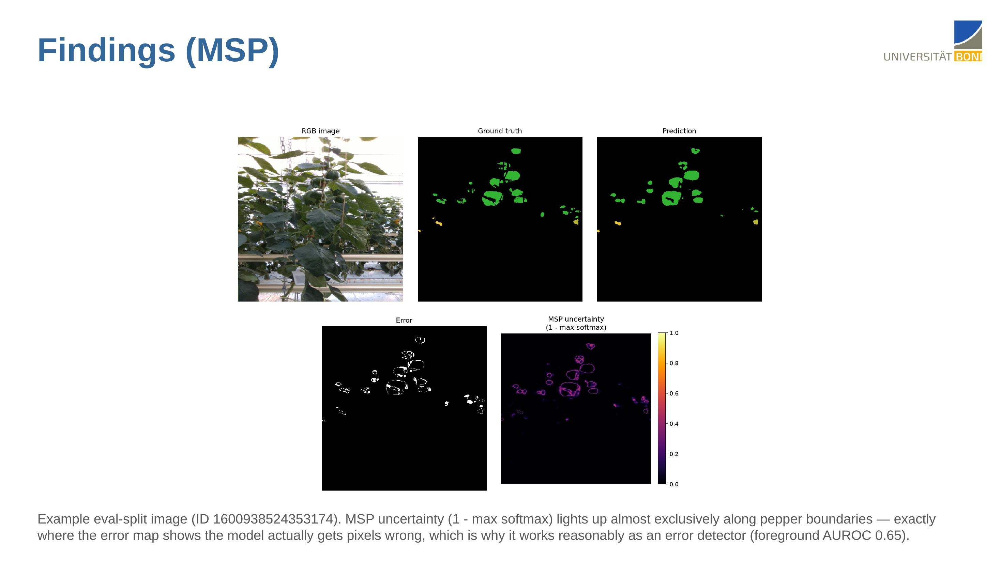
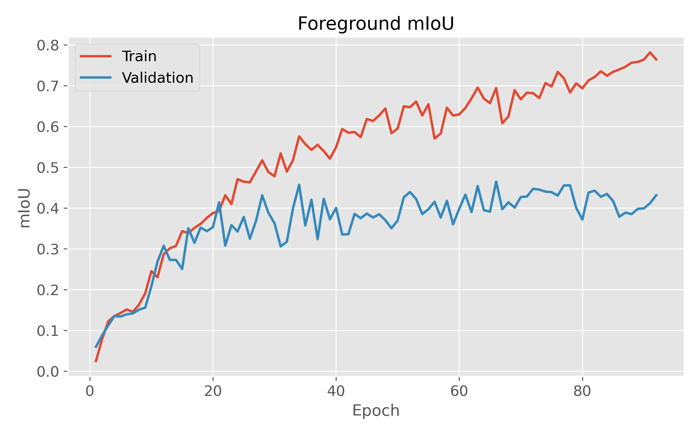
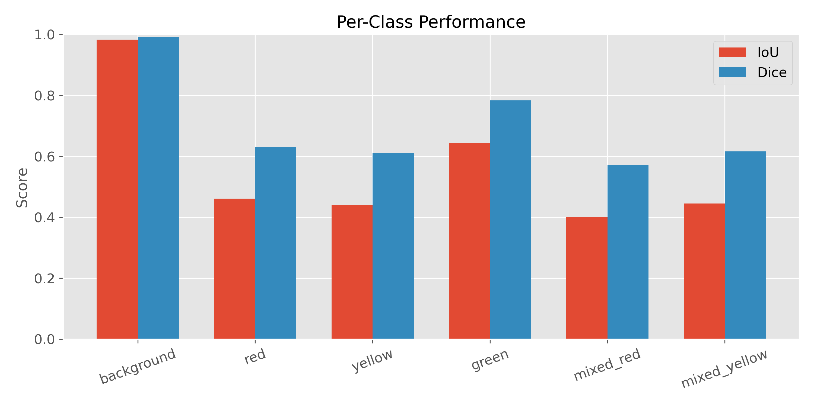
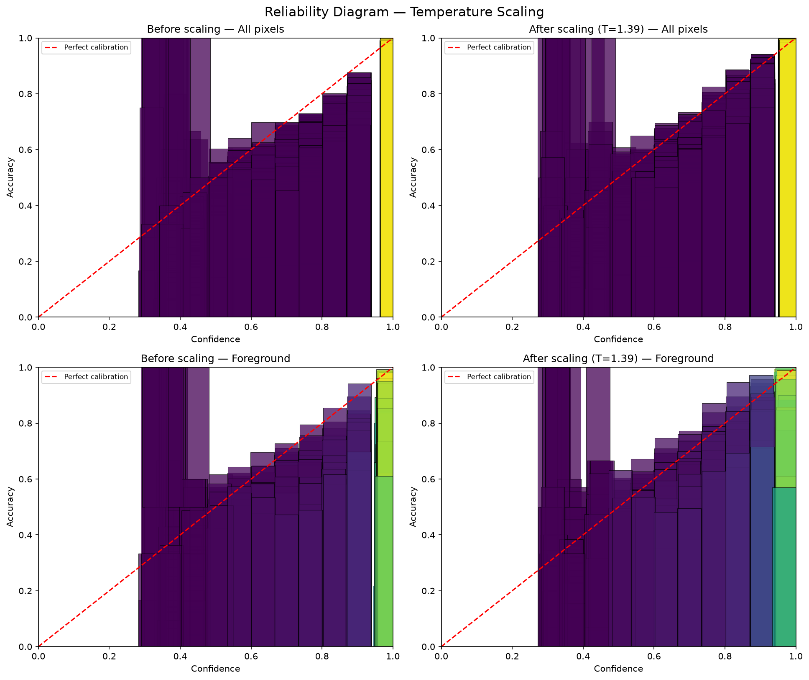
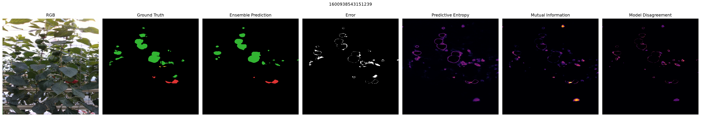
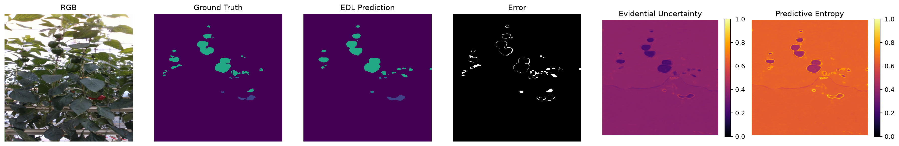

# Uncertainty Quantification for Sweet Pepper Semantic Segmentation

How far can you trust a segmentation network's confidence? I trained a **U-Net (ResNet-50 encoder)** to segment sweet peppers by ripeness in greenhouse images. On top of it I implemented and compared **5 uncertainty quantification (UQ) methods**, measuring how well each one is calibrated and whether its uncertainty points at the pixels the model gets wrong.

Research project at the **University of Bonn** (M.Sc. Robotics), using the [BUP20 Sweet Pepper Dataset](https://agrobotics.uni-bonn.de/sweet_pepper_dataset/index.html).



---

## Key results (eval split, 93 images)

| Method | Pixel acc. | Foreground mIoU | Foreground ECE ↓ | Foreground Brier ↓ | Error-detection AUROC (fg) ↑ | Error-detection AUROC (all) ↑ |
|---|---|---|---|---|---|---|
| U-Net baseline + **MSP** | 0.9805 | 0.478 | 0.227 | 0.514 | 0.647 | 0.896 |
| **Temperature Scaling** (T = 1.39) | 0.9805 | 0.478 | 0.193 | 0.487 | – | – |
| **Test-Time Augmentation** (8 views) | 0.9815 | 0.491 | 0.179 | 0.489 | 0.656 | **0.954** |
| **Deep Ensemble** (5 members) | **0.9841** | **0.540** | **0.162** | 0.411 | 0.733 | 0.943 |
| **Evidential Deep Learning** | 0.9815 | 0.481 | 0.179 | **0.375** | **0.885** | 0.377 |

*Foreground = pepper pixels only (background is ~98 % of each image and would otherwise dominate every metric). AUROC treats each method's uncertainty map as a detector of misclassified pixels.*

**Takeaways**
- **Deep Ensembles** gave the best overall model: **+6.2 points foreground mIoU** (0.478 → 0.540) and the lowest foreground calibration error, at 5× training and inference cost.
- **Evidential Deep Learning** gave the best uncertainty on peppers (**foreground AUROC 0.885**, best Brier) from a single forward pass. Its all-pixel calibration is poor (ECE 0.305), because it stays uncertain on easy background.
- **TTA** needs no retraining and was the best detector of errors over the whole image (**AUROC 0.954**).
- **Temperature Scaling** is the cheapest fix: one scalar cut foreground ECE by **15 %** without changing a single prediction.
- Across all methods, uncertainty concentrates on **pepper boundaries and occlusions**, which is where the errors are.

---

## 1. Base model: U-Net segmentation

- **Task:** per-pixel classification into 6 classes: background, red, yellow, green, mixed_red, mixed_yellow.
- **Model:** U-Net decoder on an ImageNet-pretrained ResNet-50 encoder (`src/model.py`).
- **Training:** cross-entropy + Dice loss, AdamW (lr 1e-4), ReduceLROnPlateau, mixed precision, early stopping, 512×512 inputs, on a GPU cluster with SLURM.

| Metric | All classes | Foreground |
|---|---|---|
| Pixel accuracy | 0.9805 | – |
| mIoU | 0.5626 | 0.4784 |
| mDice | 0.7011 | 0.6430 |

| Class | IoU | Dice |
|---|---|---|
| background | 0.9835 | 0.9917 |
| red | 0.4617 | 0.6317 |
| yellow | 0.4404 | 0.6115 |
| green | 0.6437 | 0.7832 |
| mixed_red | 0.4008 | 0.5723 |
| mixed_yellow | 0.4452 | 0.6161 |

| Training curve (foreground mIoU) | Per-class metrics |
|---|---|
|  |  |

---

## 2. Uncertainty quantification methods

### 2.1 Maximum Softmax Probability (MSP)
Uncertainty = 1 − max softmax probability, from one deterministic forward pass. This is the baseline every other method should beat.
`src/msp_uq.py` · [metrics](results/metrics/msp_uq_metrics.json) · [figures](results/figures/msp)

### 2.2 Temperature Scaling
Post-hoc calibration: logits are divided by one scalar **T**, fitted by minimising NLL with LBFGS on 1.26 M validation pixels. **T = 1.391**, validation NLL 0.118 → 0.106. Predictions are unchanged; only confidence is rescaled.

| Metric | Before | After |
|---|---|---|
| ECE (foreground) | 0.2269 | **0.1929** |
| Brier (foreground) | 0.5144 | **0.4869** |
| ECE (all pixels) | 0.0102 | 0.0120 |
| Brier (all pixels) | 0.0326 | **0.0316** |



`src/temperature_scaling.py` · [metrics](results/metrics/temperature_scaling_metrics.json)

### 2.3 Test-Time Augmentation (TTA)
Each image is predicted under 8 flips/rotations, the predictions are mapped back and averaged. Uncertainty = predictive entropy and disagreement between views. Mean entropy is **12× higher on wrong pixels** (0.283) than on correct ones (0.024).
`src/tta.py`, `src/tta_uq_eval.py` · [metrics](results/metrics/tta_uq_metrics.json) · [figures](results/figures/tta)

### 2.4 Deep Ensembles
5 U-Nets trained independently with different seeds (42–46). Uncertainty = predictive entropy, mutual information (epistemic part) and member disagreement.
`src/ensemble_train.py`, `src/deep_ensemble_eval.py` · [metrics](results/metrics/deep_ensemble_metrics.json) · [figures](results/figures/deep_ensemble)



### 2.5 Evidential Deep Learning
The network outputs **evidence** for a Dirichlet distribution instead of softmax probabilities. It is trained with an evidential loss plus a KL regulariser towards the uniform Dirichlet, so it can say "I don't know" in a single forward pass. Uncertainty = K / Σα.
`src/evidential_train.py`, `src/evidential_eval.py` · [metrics](results/metrics/evidential_metrics.json) · [figures](results/figures/evidential)



### Evaluation metrics (implemented from scratch)
- **Calibration:** Expected Calibration Error (15 bins), Brier score, reliability diagrams.
- **Uncertainty quality:** AUROC / AUPR of the uncertainty map as a detector of misclassified pixels.
- Everything is reported over **all pixels** and over **foreground (pepper) pixels** only.

---

## Repository structure

```
Uncertainty_Quantification/
├── src/
│   ├── config.py               # paths, hyperparameters, classes (env-var overridable)
│   ├── convert_masks.py        # COCO polygons → per-pixel PNG label masks
│   ├── dataset.py              # PyTorch Dataset + albumentations transforms
│   ├── model.py                # U-Net with ResNet-50 encoder
│   ├── train.py                # training loop (CE + Dice, AMP, early stopping)
│   ├── evaluate.py             # IoU / Dice / pixel accuracy
│   ├── visualize.py            # training curves + metric plots
│   ├── msp_uq.py               # UQ 1: max softmax probability
│   ├── temperature_scaling.py  # UQ 2: temperature scaling
│   ├── tta.py, tta_uq_eval.py  # UQ 3: test-time augmentation
│   ├── ensemble_train.py       # UQ 4: train one ensemble member
│   ├── deep_ensemble_eval.py   #       evaluate the 5-member ensemble
│   ├── evidential_train.py     # UQ 5: evidential loss + training
│   ├── evidential_eval.py      #       evidential uncertainty evaluation
│   └── mc_dropout.py           # shared ECE / Brier / AUROC helpers
├── scripts/slurm/              # SLURM batch jobs for every step
├── results/
│   ├── metrics/                # JSON + text reports for every method
│   ├── training_history/       # per-epoch loss / accuracy / mIoU
│   └── figures/                # training curves, reliability diagram, example panels per method
├── docs/                       # presentation (.pptx), slide images, result tables (.xlsx)
├── requirements.txt
└── README.md
```

## Getting started

### 1. Install
```bash
git clone https://github.com/S-SAMRINA/Uncertainty_Quantification.git
cd Uncertainty_Quantification
python -m venv venv && source venv/bin/activate
pip install -r requirements.txt
```

### 2. Data
Download BUP20 from the [Uni Bonn AgRobotics page](https://agrobotics.uni-bonn.de/sweet_pepper_dataset/index.html) and arrange it as:
```
data/
├── annotations_train.json
├── annotations_val.json
├── annotations_eval.json
└── images/<file_name from the JSON>
```
Or point to an existing copy: `export BUP20_DATA_DIR=/path/to/data`.

### 3. Run
```bash
# Base model
python src/convert_masks.py                 # label masks        → masks/
python src/train.py                         # train U-Net        → output/checkpoints/best_model.pth
python src/evaluate.py                      # baseline metrics   → output/metrics/

# Uncertainty methods
python src/msp_uq.py                        # MSP                → output/msp_uq/
python src/temperature_scaling.py           # Temperature scaling→ output/temperature_scaling/
python src/tta.py && python src/tta_uq_eval.py                       # TTA → output/tta/
for i in 1 2 3 4 5; do python src/ensemble_train.py --member $i --seed $((41+i)); done
python src/deep_ensemble_eval.py            # Deep Ensemble      → output/deep_ensemble/
python src/evidential_train.py && python src/evidential_eval.py      # EDL → output/evidential/
```
On a SLURM cluster, submit the matching script from the repo root: `sbatch scripts/slurm/<name>_job.sh`.

Model weights (`*.pth`, ~180 MB each) are not stored in the repo.

## Author

**Samrina Sheriff** · M.Sc. Robotics, University of Bonn · [LinkedIn](https://www.linkedin.com/in/samrina-sheriff-1ba649202)

Dataset: BUP20, Agricultural Robotics & Engineering, University of Bonn.

## References
- Ronneberger et al., *U-Net: Convolutional Networks for Biomedical Image Segmentation*, MICCAI 2015.
- Hendrycks & Gimpel, *A Baseline for Detecting Misclassified and Out-of-Distribution Examples*, ICLR 2017.
- Guo et al., *On Calibration of Modern Neural Networks*, ICML 2017.
- Wang et al., *Aleatoric Uncertainty Estimation with Test-Time Augmentation for Medical Image Segmentation*, Neurocomputing 2019.
- Lakshminarayanan et al., *Simple and Scalable Predictive Uncertainty Estimation using Deep Ensembles*, NeurIPS 2017.
- Sensoy et al., *Evidential Deep Learning to Quantify Classification Uncertainty*, NeurIPS 2018.
